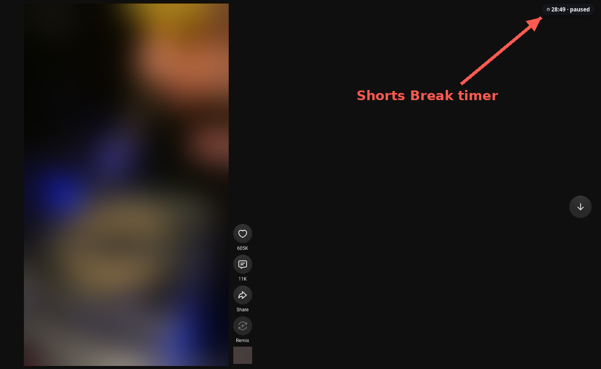
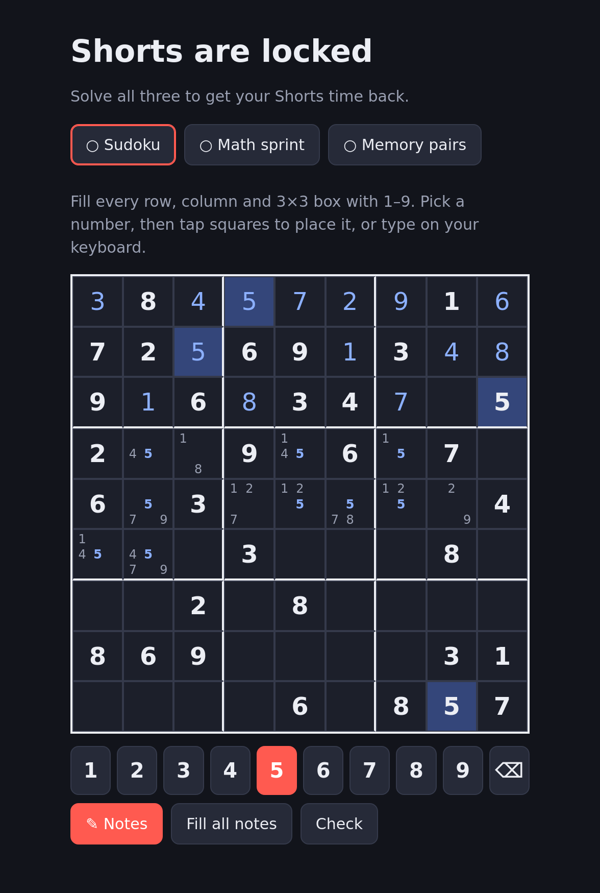
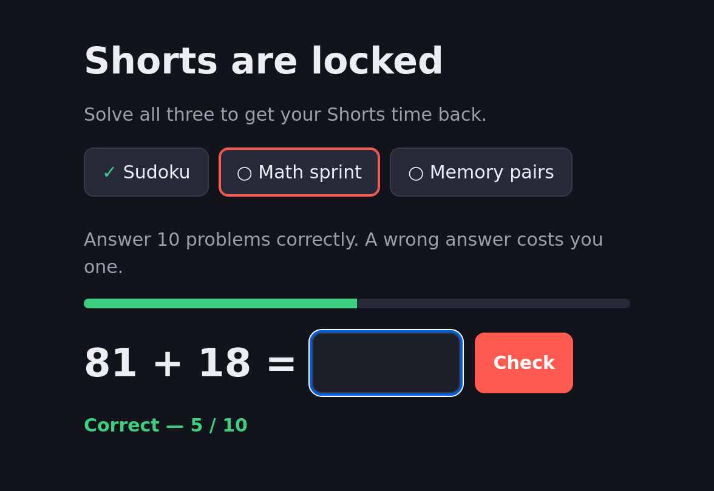
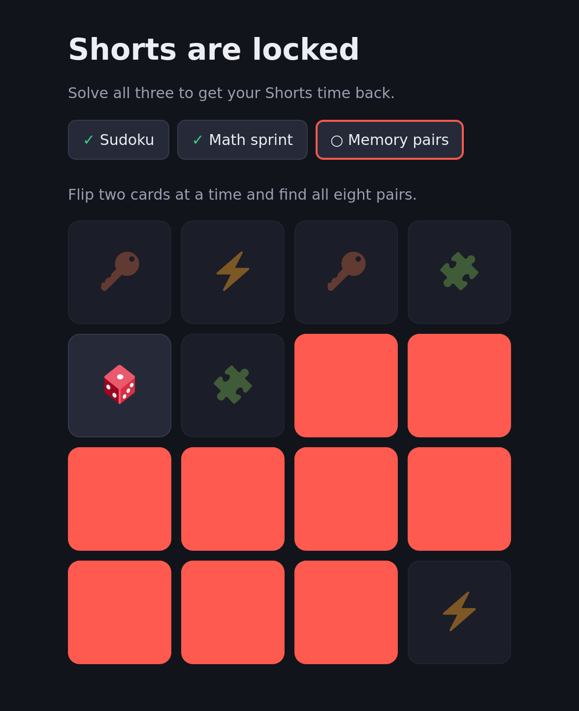
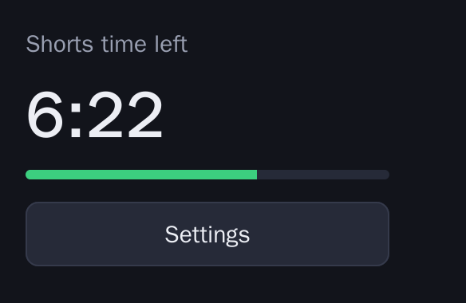
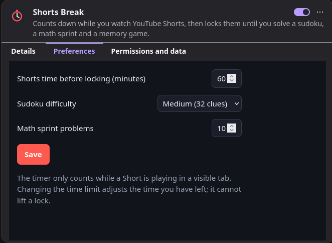

# Shorts Break

A Firefox add-on that limits how much time you spend on YouTube Shorts.

You get 10 minutes of Shorts by default. The timer only runs while a Short is playing in a tab you can see, and each second of a Short only counts once, so replays are free. When time is up, the Short you're on plays to the end and then Shorts lock. To unlock them, you solve a sudoku, a few arithmetic problems and a memory game, and your time resets.

It's a speed bump, not a hard block. You can always disable the add-on.

Available on [addons.mozilla.org](https://addons.mozilla.org/firefox/addon/shorts-break/).

## How it works

- A timer in the top-right corner of the Shorts page shows the time left. It turns red in the last minute and tells you when it isn't counting.
- Paused videos, background tabs and minimised windows don't count.
- Neither does replaying a Short, rewinding, or scrolling back to one of the last three you watched.
- While Shorts are locked, any `youtube.com/shorts` page takes you to the puzzles. The rest of YouTube works as usual.
- Solved puzzles and sudoku progress are saved, so closing the tab doesn't lose them.

## Puzzles

Sudoku: a new puzzle every time, always with exactly one solution. Pick a number on the pad below the grid and tap squares to place it, or select a square and type. The picked number is highlighted across the board, notes included. **Notes** (or the N key) switches to small pencil marks, and **Fill all notes** puts 1–9 in every empty square for you to whittle down; placing a number removes it from the notes in its row, column and box. Clashing numbers turn red as you type, and **Check** marks wrong entries in red without removing them.

Math sprint: addition, subtraction and multiplication. You need 10 correct answers, and a wrong one takes a point away.

Memory: sixteen cards, eight pairs.

## Settings

The toolbar button shows how much time you have left.

Its **Settings** button, or the add-on's **Preferences** tab in `about:addons`, lets you set:

- the time limit, 1 to 240 minutes
- the sudoku difficulty: easy, medium or hard
- how many math problems you need to get right, 3 to 30

Changing the time limit adds the difference to, or takes it from, the time you have left. It won't unlock Shorts that are already locked.

## Running it from source

Open `about:debugging#/runtime/this-firefox`, click **Load Temporary Add-on…** and pick `manifest.json`. Firefox removes temporary add-ons when it restarts.

Each release on this repository has a `shorts-break-<version>.zip`, but Firefox only installs add-ons signed by Mozilla, so use the addons.mozilla.org listing for a normal install.

## Tests

`npm ci && npm test` runs the unit tests with Node's test runner. The scripts run in jsdom with a fake `browser` API, so no browser is needed. Pull requests can't be merged until the tests and `web-ext lint` pass.

## License

GPL-3.0. See [LICENSE](LICENSE).
